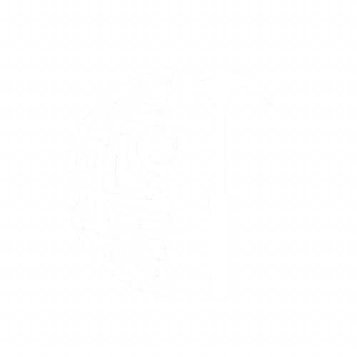

# ForgeDefender

<p align="center">
  
</p>

Foundry and Anchor in VS Code: tests, coverage, traces, deploys and security checks, without leaving the editor.
Made by [Chain Defenders](https://chaindefenders.xyz/?utm_source=forgedefender&utm_medium=marketplace&utm_campaign=readme), who audit smart contracts.

## What it does

### Tests

- **Foundry tests in VS Code's Testing view**, read from your sources before anything compiles, inherited tests included. Run one test, a contract, a file or everything; re-run on save. [More](docs/tests.md)
- **Gas** next to every test, and the change against your `.gas-snapshot`.
- **Failures on their line**, with forge's reason, fuzz counterexamples and invariant call sequences.
- **Fuzz failure → regression test** in one click: a normal test that replays exactly what failed.
- **Call traces** as a tree you can fold, linked to the code.
- **Coverage** in VS Code's coverage view.
- **Anchor tests** in the same Testing view, with compute units per test. [More](docs/solana.md)

### Security

- **Storage layout check** for upgradeable contracts, against a saved baseline. [More](docs/security.md)
- **Known-bad dependencies**: OpenZeppelin, Solady, Solmate, Anchor and SPL versions with published advisories, marked where you import them.
- **Static analysis**: Slither or Aderyn findings in the editor.
- **Audit readiness report**: nSLOC in scope, coverage, untested functions, missing NatSpec, and a `scope.txt`.
- **keymoat**: shows whether your tests and scripts run sandboxed, away from your keys. [More](docs/keymoat.md)

### Chain

- **Anvil and the Solana test validator** started, forked, reset and stopped from the sidebar, with funded accounts. [More](docs/chain.md)
- **Deploy from the editor**: dry-run or broadcast a script in a terminal, where you sign. ForgeDefender never sees a key.
- **Deployments** from `broadcast/`, with explorer links and verification.
- **Contract size** warnings against the 24 KB and 48 KB limits.
- **Selectors** on hover, and a decoder for calldata and revert data.
- **Solana**: program sizes, an IDL viewer and a PDA helper. [More](docs/solana.md)

## Requirements

- VS Code 1.91 or later.
- [Foundry](https://getfoundry.sh/) for Solidity projects, [Anchor](https://www.anchor-lang.com/) and the Solana CLI for Solana programs.
- Optional: [Slither](https://github.com/crytic/slither) or [Aderyn](https://github.com/Cyfrin/aderyn) for static analysis, and keymoat for the sandbox.

It finds every `foundry.toml` and `Anchor.toml` in the workspace, at any depth, so you can open the repository rather
than the project folder, and it handles several projects in one workspace. Its sidebar shows once it has found a
project. To choose the projects yourself, list their folders in `forgeDefender.projects`:

```json
"forgeDefender.projects": ["contracts", "programs/vault"]
```

A listed folder without a `foundry.toml` is run as a Foundry project with forge's defaults.

## Privacy

Everything runs on your machine. ForgeDefender sends no code, results or telemetry anywhere. The advisory list ships
with the extension. The only network calls are the ones you ask for: a fork's RPC, an explorer, a deploy.

## Keys

ForgeDefender never asks for, stores or passes a private key. Anything that signs runs in a VS Code terminal you can
see, with the signer you choose there (a keystore account, a hardware wallet, your Solana keypair).

## Settings

Each page in [docs/](docs) lists its settings. The tool paths (`forgeDefender.paths.forge` and others) are only needed
when a tool is not on the PATH VS Code sees.

## Building from source

```bash
npm install
npm run build          # dist/extension.js
npm run test:unit
npm run test:vscode    # starts a real VS Code; needs forge
npm run package        # forgedefender-<version>.vsix
```

`package.json` contributions are generated from `contrib/*.json` by `npm run contrib`; edit those, not `package.json`.

## Audits

When the readiness report says you are ready, [get an audit estimate](https://chaindefenders.xyz/web3?utm_source=forgedefender&utm_medium=marketplace&utm_campaign=readme#estimate).
